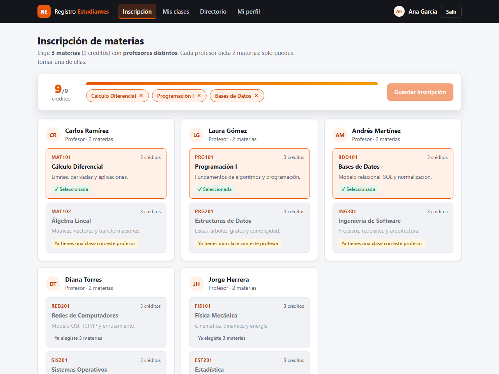

# Registro de Estudiantes

Aplicación web para que los estudiantes se registren en línea, se adhieran a un **programa de créditos** e inscriban sus materias, viendo con quién compartirán cada clase.

| Capa | Tecnología |
|---|---|
| Frontend | Angular 20 (standalone, signals, reactive forms) |
| Backend | .NET 8 Web API · Clean Architecture · EF Core · FluentValidation · JWT |
| Base de datos | SQL Server (scripts SQL como fuente de verdad) |
| Pruebas | xUnit (dominio) + script SQL de verificación de reglas |



---

## Inicio rápido

### Requisitos

| Herramienta | Versión | Descarga |
|---|---|---|
| .NET SDK | 8.0 o superior (con runtime ASP.NET Core 8) | https://dotnet.microsoft.com/download/dotnet/8.0 |
| Node.js | 20.19+ o 22 LTS | https://nodejs.org |
| SQL Server | Express, Developer o LocalDB | https://www.microsoft.com/sql-server/sql-server-downloads |
| sqlcmd | cualquiera | `winget install Microsoft.Sqlcmd` |

### Un solo comando

```powershell
git clone https://github.com/mchl27/RegistroEstudiantes.git
cd RegistroEstudiantes
.\setup.cmd
```

También puedes hacer **doble clic en `setup.cmd`**. El script:

1. Verifica los requisitos.
2. Detecta SQL Server (`.\SQLEXPRESS`, `localhost` o `(localdb)\MSSQLLocalDB`).
3. Crea la base de datos `RegistroEstudiantesDB` y **verifica las reglas de negocio en SQL**.
4. Compila el backend y ejecuta los tests.
5. Instala las dependencias del frontend.
6. Levanta la API y la web, y abre el navegador.

| URL | Qué es |
|---|---|
| http://localhost:4200 | Aplicación web |
| http://localhost:5080/swagger | Documentación interactiva de la API |

### Cuentas de demostración

Al iniciar en modo desarrollo, la API crea 4 estudiantes que comparten clases. La contraseña de todos es `Demo1234`.

| Estudiante | Correo |
|---|---|
| Ana García | ana.garcia@registro.test |
| Luis Martínez | luis.martinez@registro.test |
| Sofía Rodríguez | sofia.rodriguez@registro.test |
| Mateo López | mateo.lopez@registro.test |

En la pantalla de login hay botones para entrar con cada una.

### Opciones del script

```powershell
.\setup.cmd -SqlServer "MI_PC\SQLEXPRESS"   # usar una instancia específica
.\setup.cmd -ResetDatabase                  # recrear la base de datos desde cero
.\setup.cmd -NoStart                        # solo preparar, sin levantar nada
.\setup.cmd -SkipTests -NoBrowser           # arranque más rápido
```

### Ejecución manual (sin script)

```powershell
# 1. Base de datos
sqlcmd -S .\SQLEXPRESS -E -C -I -b -f 65001 -i database\01_schema.sql
sqlcmd -S .\SQLEXPRESS -E -C -I -b -f 65001 -i database\02_seed.sql

# 2. API (otra instancia: $env:ConnectionStrings__Default = "Server=...;Database=RegistroEstudiantesDB;Trusted_Connection=True;TrustServerCertificate=True")
dotnet run --project backend\src\RegistroEstudiantes.Api

# 3. Web (en otra terminal)
cd frontend
npm install
npm start
```

---

## Reglas de negocio y dónde se garantizan

Cada regla se valida en **tres capas**: la interfaz la previene, la API la explica y la base de datos la garantiza (incluso ante peticiones concurrentes).

| # | Regla | Interfaz (Angular) | API (.NET) | Base de datos |
|---|---|---|---|---|
| 1 | CRUD de registro en línea | Registro, perfil, eliminar cuenta | `AuthController`, `StudentsController` | Índices únicos filtrados de correo y documento |
| 2 | Adhesión a un programa de créditos | Se asigna al registrarse | `AuthService` | FK `Student → CreditProgram` |
| 3 | Existen 10 materias | Catálogo agrupado por profesor | `GET /api/subjects` | `02_seed.sql` |
| 4 | Cada materia vale 3 créditos | Contador `x/9 créditos` | `EnrollmentRules` | `CHECK (Credits = 3)` |
| 5 | Solo 3 materias | Se bloquean las demás al llegar a 3 | `Student.Enroll` (422) | `Slot 1..3` + `UNIQUE (StudentId, Slot)` |
| 6 | 5 profesores con 2 materias cada uno | Tarjeta por profesor | Modelo `Subject` | `UNIQUE (ProfessorId, ProfessorSlot)` |
| 7 | No repetir profesor | Se bloquea la otra materia del profesor | `Student.Enroll` (422) | `UNIQUE (StudentId, ProfessorId)` + FK compuesta |
| 8 | Ver los registros de otros estudiantes | Directorio con búsqueda, actualizado cada 15 s | `GET /api/students` | — |
| 9 | Ver solo el nombre de los compañeros de clase | Mis clases | `GET /api/enrollments/me` (DTO solo con nombres) | — |

---

## Arquitectura

```
┌──────────────┐  HTTP/JSON + JWT  ┌─────────────────────────────────────────────┐   EF Core   ┌────────────┐
│  Angular 20  │ ────────────────► │ Api → Application → Domain                  │ ──────────► │ SQL Server │
│  (puerto 4200)│   proxy /api      │        ↑                                    │             │            │
└──────────────┘                   │  Infrastructure (EF Core, hash, repos)      │             └────────────┘
                                   └─────────────────────────────────────────────┘
```

| Proyecto | Responsabilidad | Depende de |
|---|---|---|
| `Domain` | Entidades y reglas de negocio puras (`Student.Enroll`) | nada |
| `Application` | Casos de uso, DTOs, validaciones, puertos (interfaces) | Domain |
| `Infrastructure` | EF Core, repositorios, unidad de trabajo, hash de contraseñas | Application |
| `Api` | Controladores, JWT, manejo global de errores (ProblemDetails), Swagger | Application, Infrastructure |

```
database/    01_schema.sql · 02_seed.sql · 03_verify_rules.sql
backend/     src/{Domain, Application, Infrastructure, Api} · tests/
frontend/    src/app/{core, shared, layout, features}
docs/        Documento de entrega
setup.ps1    Instalación y arranque en un paso
```

### API

| Método | Ruta | Auth | Descripción |
|---|---|---|---|
| POST | `/api/auth/register` | — | Registro del estudiante |
| POST | `/api/auth/login` | — | Inicio de sesión (devuelve JWT) |
| GET | `/api/subjects` | — | Catálogo de materias con profesor e inscritos |
| GET / PUT / DELETE | `/api/students/me` | JWT | Ver, editar o eliminar el propio registro |
| GET | `/api/students` | JWT | Directorio de estudiantes (regla 8) |
| GET | `/api/enrollments/me` | JWT | Mis clases y compañeros (regla 9) |
| PUT | `/api/enrollments/me` | JWT | Inscribir exactamente 3 materias (reglas 5 y 7) |

Los errores siguen **ProblemDetails (RFC 7807)** con un `code` estable:

| HTTP | Cuándo | Ejemplo de `code` |
|---|---|---|
| 400 | Datos con formato inválido | `validation` |
| 401 | Credenciales o token inválidos | `auth.invalid_credentials` |
| 404 | Recurso inexistente | `subject.not_found` |
| 409 | Conflicto con datos existentes | `student.email_taken` |
| 422 | Regla de negocio incumplida | `enrollment.same_professor` |

---

## Pruebas

```powershell
# Tests unitarios del dominio (11)
dotnet test backend\RegistroEstudiantes.sln

# Verificación de reglas directamente en SQL Server (11 casos, sin dejar datos)
sqlcmd -S .\SQLEXPRESS -E -C -I -f 65001 -W -i database\03_verify_rules.sql
```

---

## Solución de problemas

| Síntoma | Solución |
|---|---|
| `No se pudo conectar a SQL Server` | Indica la instancia: `.\setup.cmd -SqlServer "localhost"` |
| La ejecución de scripts está deshabilitada | Usa `setup.cmd` (aplica `-ExecutionPolicy Bypass` solo a este script) |
| El puerto 5080 o 4200 está ocupado | El script reutiliza lo que ya corre; si es otra app, ciérrala |
| Quiero volver a los datos de demostración | `.\setup.cmd -ResetDatabase` y reinicia la API |

---

## Documentación de la entrega

El documento con supuestos, decisiones técnicas, modelo de datos y evidencias de las pruebas está en [`docs/Entrega.pdf`](docs/Entrega.pdf) (fuente: [`docs/entrega.html`](docs/entrega.html)).
